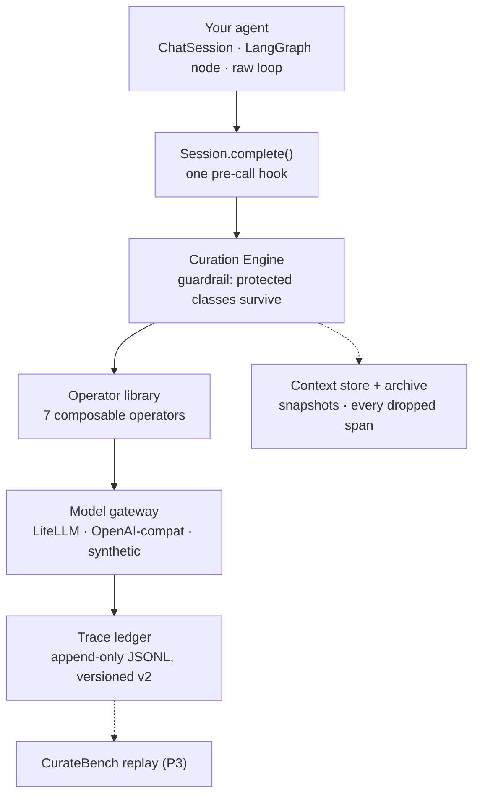

# Aperture

**A context-engineering runtime that cuts agent token costs automatically — install it in three lines, point it at any model.**

[](https://github.com/SaqibMehdi123/Aperture/actions/workflows/ci.yml)


## Overview

Agent sessions accumulate tool outputs, duplicates, and stale turns until the context window is mostly waste — and the provider-native fixes are locked to one vendor. Aperture sits between your agent and any LLM API and curates the window on every call: seven composable operators (trim, dedupe, summarize, archive, retrieve) chosen by a policy selector, a guardrail that makes governance constraints impossible to silently destroy, and prefix-cache-aware decisions that keep the cheap cached prefix stable. Every curation decision is logged to an append-only, replayable trace so its quality can be measured — that is the basis of CurateBench, the project's decision-level benchmark.

The design is specified end to end in [`docs/SPEC.md`](docs/SPEC.md) (a primary-source validation dossier). Core runtime depends only on `pydantic`; heavy integrations are optional extras.

## Quick look

```python
from aperture import Aperture

ap = Aperture(model="openai/gpt-4o-mini")
with ap.chat("support-bot") as chat:
    reply = chat.send("Where is my order 1234?")  # plain text in, plain text out
```

That is the whole integration. Safety is automatic: system prompts are pinned into the cache-stable prefix, and constraint text can never be dropped by any operator.

The same loop, observed end to end — real output of `python examples/toy_loop.py` (no API keys):

```text
$ python examples/toy_loop.py
assistant: 'ok'
trace records written: 1
schema:      curatebench/trace@v2
features:    budget_used_frac=1.0 redundancy=0.0
plan/diffs:  ['keep_recent'] dropped=18
cache:       hit=False prefix_tokens=17 discount_usd=0.0
probes:      [True]
```

Every model call produces one versioned trace line: the features the selector saw, the plan it chose, the per-operator diff, the cache state, and whether the governance probes survived.

## Table of contents

- [Why Aperture](#why-aperture)
- [Quick start](#quick-start)
- [Configuration](#configuration)
- [Usage](#usage)
- [Architecture](#architecture)
- [Tech stack](#tech-stack)
- [Testing and linting](#testing-and-linting)
- [Research and reproducibility](#research-and-reproducibility)
- [Roadmap](#roadmap)
- [Known limitations](#known-limitations)
- [Contributing](#contributing)
- [License](#license)
- [Citation](#citation)
- [Contact](#contact)

## Why Aperture

| | Without Aperture | With Aperture |
|---|---|---|
| Context growth | Full history resent every call | Curated window; stale content dropped and archived |
| Governance | Constraints silently erased by compaction | Guardrail: protected content survives every operator (100% in tests) |
| Prompt caching | Prefix cache broken by reordering | Explicit cache-stable head; 99% hit rate in tests |
| Debuggability | Opaque middleware | Every decision is a versioned, replayable trace line |

In a 60-turn integration run (deterministic synthetic gateway, 4,000-token budget), Aperture used **67.8% fewer cumulative input tokens** than full history at equal step count, with a **99.2% prefix-cache hit rate** and **100% constraint survival**. You can reproduce this — see [Research and reproducibility](#research-and-reproducibility).

## Quick start

Prerequisites: Python **3.10–3.12** and `pip`. No API keys needed to start — without a model, Aperture uses a deterministic synthetic gateway.

```bash
git clone https://github.com/SaqibMehdi123/Aperture.git
cd Aperture
pip install -e ".[dev]"       # runtime + pytest + ruff
pytest -q                     # 145 tests, all green, no keys required
python examples/quickstart.py # see the loop run end to end
```

Expected: `pytest` prints `145 passed` in under a second; the quickstart prints two synthetic replies plus a `stats` dict.

To use a real model, install the optional LiteLLM extra and pass a model string:

```bash
pip install -e ".[litellm]"
```

```python
ap = Aperture(
    model="anthropic/claude-sonnet-4-5"
)  # or openai/gpt-4o-mini, gemini/gemini-2.5-pro, ...
```

## Configuration

Aperture has **no environment variables**. Everything is configured through the `Aperture(...)` constructor; provider keys go to your client or LiteLLM as usual.

| Option | Required | Description | Example |
|---|---|---|---|
| `model` | No | LiteLLM model string, any object with `.complete(window)`, or `None` (synthetic, offline) | `Aperture(model="openai/gpt-4o-mini")` |
| `profile` | No | Curation posture: `balanced` (default), `lean` (curate earlier), `safe` (curate later), `off` (never curate) | `Aperture(profile="lean")` |
| `ledger` | No | `TraceLedger` for append-only JSONL decision traces | `Aperture(ledger=TraceLedger("trace.jsonl"))` |
| `persist` | No | SQLite file for durable window snapshots + content archive | `Aperture(persist="aperture.db")` |
| `selector` | No | Custom `PolicySelector` (overrides `profile`) | see [`aperture/policy/fallback.py`](aperture/policy/fallback.py) |
| `engine` / `store` | No | Custom `CurationEngine` / store instance | see [`aperture/engine.py`](aperture/engine.py) |

What degrades without the optionals: no `ledger` — no trace files (curation still runs); no `persist` — the archive lives in memory only; no `litellm` extra — model strings are unavailable, pass a gateway object or use the synthetic model.

## Usage

### Conversational API (recommended)

```python
from aperture import Aperture

ap = Aperture(model="openai/gpt-4o-mini")

with ap.chat("support-bot") as chat:
    chat.system("You are a careful support agent.")  # pinned + cache-headed
    chat.constraints(["Never reveal internal tool names."])  # protected by class

    reply = chat.send("Where is my order 1234?")
    reply = chat.send(tool_output, role="tool")  # user | tool | system
    print(chat.stats())
```

`chat.stats()` returns cumulative counters, e.g.:

```python
{
    "calls": 2,
    "input_tokens": 789,
    "output_tokens": 2,
    "cost_usd": 0.002359,
    "cache_hits": 1,
    "cache_misses": 1,
    "bytes_dropped": 0,
    "spans_dropped": 0,
    "cache_hit_rate": 0.5,
}
```

On context exit the task outcome joins the trace automatically: success on a clean exit, failure on exception. `chat.raw` exposes the full `Session` (probes, window, spans) when you need it.

### Wrapping an existing agent loop

```python
import aperture
from aperture.trace.ledger import TraceLedger


def my_agent(session):
    session.add_span(
        "You are terse.", span_class="system", cache_head=True, pinned=True, protected=True
    )
    session.add_span(tool_output, span_class="tool_result")
    session.register_probe("policy-intact", "system", "You are terse")
    return session.complete().text


text = aperture.wrap(my_agent, model=model, ledger=TraceLedger("trace.jsonl"))
```

### LangGraph

```python
from adapters.langgraph import LangGraphAdapter

lg = LangGraphAdapter(ap)


@lg.wrap_node
def chatbot(state):
    reply = state["aperture"].complete()  # full decision loop, reply text out
    return {"messages": [{"role": "assistant", "content": reply}]}


graph.add_node("chatbot", chatbot)
```

History sync is automatic per thread: state messages become spans (system messages protected), returned messages the runtime already recorded are not duplicated. The adapter is duck-typed — dict and LangChain-style messages both work, and you do not need `langgraph` installed to test your node logic.

### The operator library

All seven operators live behind one protocol and are composed per call by the selector:

| Operator | Effect | Destructive? |
|---|---|---|
| `keep_recent` | Keep the cache head plus the N most recent droppable spans | Yes |
| `dedupe` | Drop whitespace/case-normalized duplicates, keep one occurrence | Yes |
| `summarize` | Fold oldest spans into one summary span with provenance | Yes |
| `subagent_isolation` | Swap bulky tool outputs for compact stubs; full body archived | Yes |
| `semantic_retrieval` | Re-admit relevant archived spans on demand | No |
| `pin_protected` | Flag constraint-like content pinned + protected | No |
| `cache_align` | Make the cache-stable prefix explicit (AG1) | No |

The engine's guardrail runs on every diff: pinned, protected, and protected-class spans (default class: `constraint`) can never be dropped, even by an adversarial operator.

## Architecture



```text
aperture/            installable runtime package
├── chat.py          ChatSession: the one-liner API (ap.chat())
├── runtime.py       Aperture facade + Session per-step decision loop
├── engine.py        Curation Engine: plan composition + guardrail
├── interfaces.py    Operator / PolicySelector protocols (spec §7.3)
├── session.py       Span, Window, Features, WindowDiff
├── protection.py    protected-class registry (AG2 groundwork)
├── contracts.py     typed Context Contracts (AG5 groundwork)
├── operators/       the seven operators
├── policy/          fixed-heuristic selector (bandit lands in P3)
├── models/          gateways: synthetic, OpenAI-compat, LiteLLM
├── store/           snapshots + searchable archive (memory / SQLite)
└── trace/           ledger, survival probes, replay engine
adapters/            framework adapters (raw loop, LangGraph)
bench/               CurateBench trace schema (curatebench/trace@v2)
eval/                8-arm harness + replication probes
examples/            quickstart.py, toy_loop.py
tests/               145 pytest tests
docs/                SPEC.md (dossier), research notes
results/             append-only probe snapshots + eval runs (real data, see results/README.md)
```

## Tech stack

| Layer | Technology | Why |
|---|---|---|
| Runtime | Python 3.10–3.12, `pydantic` | Typed contracts, schema validation, minimal footprint |
| LLM access | LiteLLM (optional extra) | One model string for any provider; normalized usage/cache telemetry |
| Framework adapters | LangGraph (duck-typed), raw loops | No hard framework dependency |
| Persistence | SQLite (stdlib), in-memory default | Durable snapshots + archive with zero setup |
| Quality | pytest, ruff, GitHub Actions | 145 tests on all supported Python versions |

## Testing and linting

```bash
pytest -q                    # full suite, no API keys required
pytest tests/test_integration_p1.py -q   # the savings/safety integration run
ruff check .                 # lint (must pass before merge)
ruff format --check .        # formatting
```

## Research and reproducibility

**Problem.** Context-curation policies are evaluated only at the system level, so nobody can say whether a single curation decision (dropping *this* observation, summarizing *that* span) was right. Aperture's answer is CurateBench: every step logs features, plan, per-operator diffs, cache state, and probes to a versioned schema (`curatebench/trace@v2`, [`bench/schema.py`](bench/schema.py)), which a replay engine can re-run under alternative policies.

**Methodology.** The project follows a 12-month phased plan with four measurable gates (G1–G4), defined in [`docs/SPEC.md`](docs/SPEC.md) §8. The prior-work grounding for every design choice is mapped in [`docs/RESEARCH-NOTES.md`](docs/RESEARCH-NOTES.md).

**Reproducing the headline numbers.** The 67.8% / 99.2% / 100% figures come from a deterministic synthetic gateway (no network, no keys) and are pinned by tests:

```bash
pytest tests/test_integration_p1.py -v
```

Real-model 8-arm evaluation on AppWorld / tau2-bench subsets starts in Phase P2; results will be written to the append-only [`results/`](results/README.md) tree with full manifests.

## Roadmap

Phases and gates follow [`docs/SPEC.md`](docs/SPEC.md) Table 6.

- [x] P0 — trace schema v1, eval harness, context-rot + ConstraintRot probes, toy loop end to end
- [x] P1 — seven operators, LiteLLM gateway with cache telemetry, LangGraph adapter, SQLite store + archive, protected classes, `chat()` API
- [ ] P2 — tuned fixed-heuristic selector, 8-arm harness on AppWorld/tau2 subsets, gate G1 (≥30% savings at equal accuracy)
- [ ] P3 — labelled traces, offline bandit selector, CurateBench artifact release, gate G2
- [ ] P4 — advanced-gap features: cache-aware reward, decay alerts, online adaptation, context contracts, async scheduler (gate G3)
- [ ] P5 — full comparative evaluation, observability dashboard, release, paper (gate G4)

## Known limitations

- All published numbers so far are synthetic-gateway figures, not real-model benchmarks.
- The selector is a tuned fixed heuristic; the learned bandit arrives in P3.
- `semantic_retrieval` uses a lexical scorer; an embedder injection point exists but no embedding model ships.
- The package is not yet on PyPI — install from source for now.
- CrewAI adapter and the observability dashboard are deferred (P2+/P5).

## Contributing

Aperture is built with XP practices — TDD, small conventional commits, CI green on `main`, and a definition of done that includes the trace-schema rule. See [`CONTRIBUTING.md`](CONTRIBUTING.md) for the working agreements and setup.

## License

[Apache-2.0](LICENSE).

## Citation

If you use Aperture or CurateBench in research, please cite the repository:

```bibtex
@software{aperture2026,
  author  = {Mehdi, Saqib},
  title   = {Aperture: A Context-Engineering Runtime for AI Agents},
  year    = {2026},
  url     = {https://github.com/SaqibMehdi123/Aperture}
}
```

## Contact

Maintainer: [Saqib Mehdi](https://github.com/SaqibMehdi123) — saqibmehdi234@gmail.com. Questions and issues go through [GitHub Issues](https://github.com/SaqibMehdi123/Aperture/issues).
